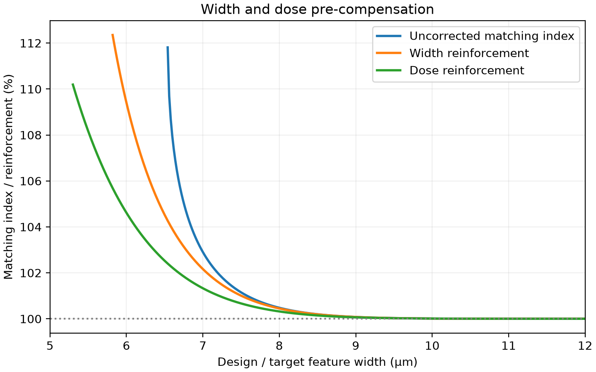
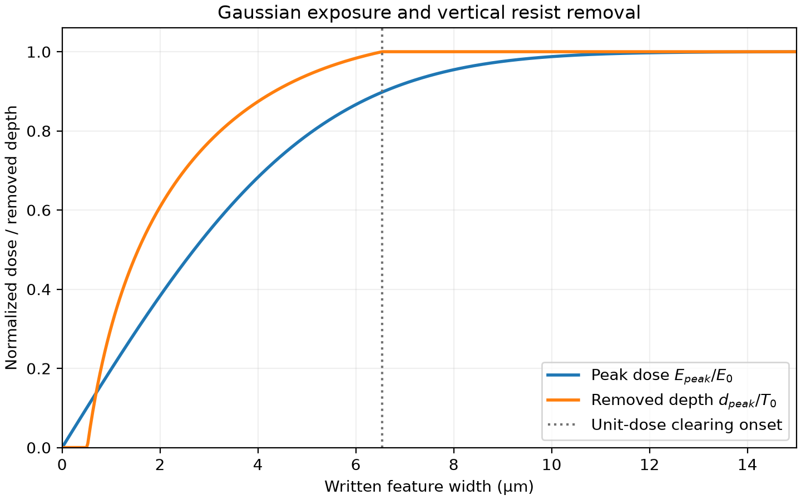
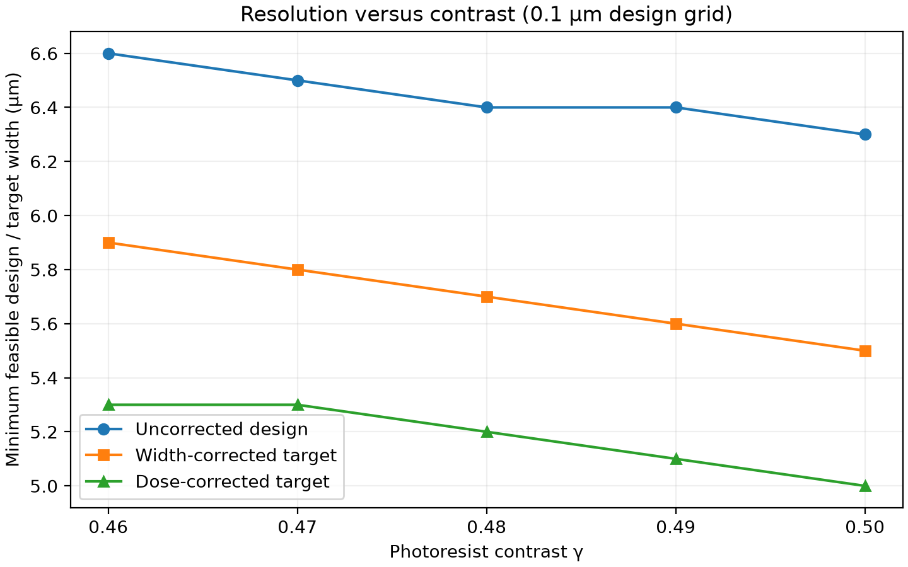
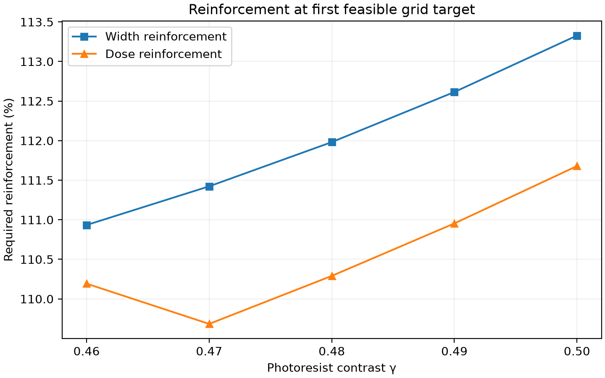

# DMDLitho

[](https://github.com/yuedawang/DMDLitho/actions/workflows/tests.yml)

A lightweight numerical reproduction of model-based optical proximity
correction (OPC) for DMD-based maskless lithography, following Hur & Seo (2012).

| Quantity | Paper | DMDLitho |
|---|---:|---:|
| Matching index at 6.6 µm | 107.8% | 107.96% |
| Width reinforcement at 5.9 µm | 110.9% | 110.93% |
| Dose reinforcement at 5.4 µm | 109.1% | 109.13% |

These key published values are reproduced within 0.2 percentage points.
Values come from [the generated numerical summary](results/fig6_summary.json);
the resolution-limit discrepancy is explained in [Reproduction notes](#reproduction-notes).



## Why maskless lithography still needs OPC

Removing the fabricated photomask does not remove optical blur or the
resist's nonlinear dose response: the printed critical dimension (CD) can
still differ from the target width. Conventional OPC modifies a physical
photomask; DMD lithography can pre-compensate written geometry or
programmable exposure dose.

**Current v0.1 model:** accumulated Gaussian exposure → simplified positive
resist response → CD prediction → width or dose pre-compensation.


**Status: v0.1.0.** Reproduces the isolated 1D analytical simulations in
Figs. 5–7. Explicit 2D DMD scanning and experimentally calibrated process
prediction are outside the current model.

## Quick start

Python >=3.10 is required; the local validation and CI configuration use
Python 3.11. In Windows PowerShell, from the project directory:

```powershell
python -m venv .venv
.\.venv\Scripts\Activate.ps1
python -m pip install -e ".[dev]"
python -m pytest -q
python scripts/reproduce_fig5.py
python scripts/reproduce_fig6.py
python scripts/reproduce_fig7.py
```

The `dev` extra installs pytest alongside the NumPy, SciPy and Matplotlib
runtime dependencies. Activation is optional: use
`.\.venv\Scripts\python.exe` directly if PowerShell blocks the activation
script. Output paths are resolved relative to the project, independent of
the calling directory. The scripts use a noninteractive plotting backend,
save 200-DPI PNGs, and print ASCII `um` for Windows console compatibility.

## Relation to MiniOPC-CUDA

[MiniOPC-CUDA](https://github.com/yuedawang/MiniOPC-CUDA) studies conventional
mask-based computational lithography by modifying a computational mask.
DMDLitho studies maskless lithography by changing written feature geometry
or programmable exposure dose. The conceptual progression is from physical
mask correction to programmable exposure correction; DMDLitho is a separate
implementation, not a fork or code extension of MiniOPC-CUDA.

## Source paper

Jungyu Hur and Manseung Seo, “Optical Proximity Corrections for Digital
Micromirror Device-based Maskless Lithography,” *Journal of the Optical
Society of Korea* **16**(3), 221–227 (2012).
[DOI: 10.3807/JOSK.2012.16.3.221](https://doi.org/10.3807/JOSK.2012.16.3.221).
The original method belongs to the paper's authors. The local source PDF
was read to check equation numbering, Fig. 4 geometry, Figs. 5–7 and
Section 4.1; it is outside this project and is not included here.

## Model and units

All lengths in the API are micrometers (µm); normalized doses are
dimensionless ratios to the same saturation dose $E_0$. The paper calls
$w$ the Gaussian radius; the formulas below define its convention.

For an isolated written interval of width $l$, the accumulated exposure
is the integral of a projected Gaussian. Eq. (4) gives

$$
q(x)=\frac{E(x)}{E_0}=\frac12\left[
\mathrm{erf}\left(\frac{x+l/2}{\sqrt2 w}\right)-
\mathrm{erf}\left(\frac{x-l/2}{\sqrt2 w}\right)\right].
$$

Eq. (7) gives the center peak:

$$q(0)=\mathrm{erf}\left(\frac{l}{2\sqrt2 w}\right).$$

The positive-resist contrast relation in Eq. (5) is
$\gamma=1/\ln(E_{cl}/E_{th})$. Define $r_{th}=E_{th}/E_0$ and
$r_{cl}=E_{cl}/E_0$. Eq. (6) is implemented as normalized **removed** depth:

- For $q<r_{th}$: $d/T_0=0$.
- For $r_{th}\le q<r_{cl}$: $d/T_0=\gamma\ln(q/r_{th})$.
- For $q\ge r_{cl}$: $d/T_0=1$.

For dose correction replace $q$ by $\alpha q$. Zero removed depth means
no development; one means complete clearing. Remaining thickness is
$T_0(1-d/T_0)$. Explicit names avoid the ambiguity of the paper's $t(x)$
and its discussion of removed versus remaining depth. This is a vertical
development approximation, not a calibrated resist-development simulator.

The positive-side crossings are $\alpha q(x_{top})=r_{th}$ and
$\alpha q(x_{bottom})=r_{cl}$. Symmetry places the opposite edges at
$-x_{top}$ and $-x_{bottom}$, so Fig. 4 defines

$$
CD_{top}=2x_{top},\quad CD_{bottom}=2x_{bottom},\quad
CD=\frac{CD_{top}+CD_{bottom}}2=x_{top}+x_{bottom}.
$$

Brent's method solves the actual crossings, independently of plotting
grids. A Gaussian-tail bound sets the spatial bracket. If the center never
reaches $E_{cl}$, `CDResult.cd_um` and `cd_bottom_um` are `None` and
`fully_cleared=False`; `cd_top_um` can still exist. At exact clearing onset
the bottom touches the substrate at one point: its width is zero. This
limiting case is accepted mathematically, without implying a useful
manufacturing process window. Invalid numerical inputs raise `ValueError`.

The matching index is $100l/CD$ (%). **Width pre-compensation** solves
$CD(l_{write},\alpha=1)=l_{target}$, changing geometry at fixed dose, and
reports $100l_{write}/l_{target}$. **Dose pre-compensation** fixes
$l_{write}=l_{target}$ and solves $CD(l_{target},\alpha)=l_{target}$,
reporting $100\alpha$. Both use deterministic bracketing. Targets below
the fully-cleared branch raise `UnachievableTargetError`; no published
answers are embedded in the model.

## Parameters and reproduction inference

| Directly reported in Section 4.1 | Default | Meaning |
|---|---:|---|
| $\gamma$ | 0.46 | Positive-resist contrast |
| $E_{th}/E_0$ | approximately 0.1 | Rounded threshold ratio |
| $T_0$ | 1 µm | Initial resist thickness |
| $w$ | 2 µm | Gaussian beam radius in Eqs. (4), (7) |

Two threshold modes are deliberately separate:

- **Literal:** `literal_thresholds(gamma)` uses $r_{th}=0.1$ and derives
  $r_{cl}=0.1\exp(1/\gamma)$ from Eq. (5).
- **Reconstructed (default):** `reconstructed_thresholds(gamma)` imposes
  the **reproduction inference** $r_{th}+r_{cl}=1$. Combined with Eq. (5),
  it gives $r_{th}=1/(1+\exp(1/\gamma))$ and $r_{cl}=1-r_{th}$.

**Hur & Seo do not explicitly state the sum-to-one condition.** It is an
implementation inference recovering the wide-feature zero-CD-bias behavior:
complementary thresholds give opposite edge offsets whose average cancels
when the two Gaussian edges no longer interact. The paper reports
$\gamma=0.46$ and rounded $r_{th}=0.1$, but does not state every normalized
quantity needed to reconstruct its curves. At $\gamma=0.46$, reconstruction
gives $r_{th}=0.10211769$ and $r_{cl}=0.89788231$. Literal mode preserves the
rounded report and yields a different, nonzero wide-feature CD bias.

| Additional implementation choices | Purpose / status |
|---|---|
| $r_{th}+r_{cl}=1$ | Inferred normalization, **not** a paper equation |
| 0.1 µm design grid for Fig. 7 markers | Inferred reporting grid; paper does not specify its sweep pitch |
| Continuous clearing-onset limits | Independently solved analytical/numerical limits, not fitted reported widths |

Each contrast in Fig. 7 recomputes its own threshold pair. Thickness sets
the physical depth scale but cancels from this normalized CD model.

## Reproduced figures

The results use reconstructed thresholds. The top table summarizes
`scripts/reproduce_fig6.py`: its deviations from the paper are +0.16,
+0.03 and +0.03 percentage points, within the regression tolerance of ±0.3.



Peak dose and removed depth increase monotonically; the depth reaches
complete removal at the unit-dose clearing onset, 6.5387 µm.

**Fig. 6**, shown at the top, demonstrates how width and dose correction
reduce CD error; dose correction reaches smaller target widths. At the
6.6 µm uncorrected design width, the printed CD is 6.1135 µm. The corrected
5.9 µm target needs a written width of 6.5451 µm; the corrected 5.4 µm
target needs dose scale 1.09129.

The matching index and both reinforcements approach 100% for wide features.
Fig. 6 uses a finer plotting grid than the Fig. 7 reporting grid, so its
curves extend toward continuous feasibility boundaries rather than stopping
at the paper's reported tenths.



Increasing resist contrast improves achievable resolution. The plotted
design-grid limits are distinct from the continuous printed-CD limits.



Dose correction requires less reinforcement than width correction over
the studied contrast range at the first feasible grid targets.

The sweep output is saved in `results/fig7_summary.json`. The following
grid values were produced by `scripts/reproduce_fig7.py`:

| Contrast | Uncorrected design (µm) | Width target (µm) | Dose target (µm) | Width reinforcement (%) | Dose reinforcement (%) |
|---:|---:|---:|---:|---:|---:|
| 0.46 | 6.6 | 5.9 | 5.3 | 110.93 | 110.19 |
| 0.47 | 6.5 | 5.8 | 5.3 | 111.42 | 109.68 |
| 0.48 | 6.4 | 5.7 | 5.2 | 111.98 | 110.29 |
| 0.49 | 6.4 | 5.6 | 5.1 | 112.61 | 110.95 |
| 0.50 | 6.3 | 5.5 | 5.0 | 113.33 | 111.68 |

Continuous resolution limits strictly decrease with increasing contrast.
The reporting grid introduces plateaus and a small nonmonotonicity in dose
reinforcement at the first grid target. Dose reinforcement remains below
width reinforcement at every studied contrast. These are independently
computed curves, not digitized paper plots.

## Reproduction notes

For $\gamma=0.46$, the continuous minimum **written/design** width that
clears at unit dose is 6.5387 µm; its printed mean CD is 5.8085 µm.
The width-corrected target limit is also 5.8085 µm. The continuous
dose-corrected target limit is 5.2976 µm. Selecting the first feasible
0.1 µm grid targets gives **6.6 / 5.9 / 5.3 µm**, versus the paper's
reported **6.6 / 5.9 / 5.4 µm**.

The 5.3 µm dose-corrected target lies very near mathematical clearing onset
and is allowed by the specified model. The paper does not supply all
discretization, sampling or rounding details needed to establish the precise
cause of the difference from its reported 5.4 µm. It also provides no
explicit finite bottom-width or process-margin criterion explaining that
cutoff. DMDLitho does not attribute the discrepancy to a specific cause
or tune a criterion to eliminate it; reinforcement is separately compared
at the published 5.4 µm target.
Consequently the Fig. 7 dose curve at contrast 0.46 has reinforcement
110.19% at 5.3 µm, rather than 109.13% at 5.4 µm. It is a near reproduction
of the model and trends, not an exact reconstruction of every curve point.

The paper uses “achievable CD” for some values corresponding to design
widths. DMDLitho explicitly distinguishes those from computed printed CD
in the API, summary files and plot labels. Section 4.1 also says the matching
index decreases to “0%”; Fig. 6 and the definition $100l/CD$ instead show
an approach to **100%**. The implementation follows the definition and
figure rather than propagating that apparent textual error.

## Python API example

```python
from dmdlitho import LithographyParameters, compute_cd, solve_dose_correction

parameters = LithographyParameters()
uncorrected = compute_cd(6.6, parameters, threshold_mode="reconstructed")
corrected = solve_dose_correction(5.4, parameters)
print(uncorrected.cd_um, corrected.dose_scale)
```

## Code map and validation

- `src/dmdlitho/parameters.py`: reported parameters and explicit threshold modes.
- `exposure.py`: Eqs. (4), (7), including numerically stable Gaussian tails.
- `resist.py`: Eq. (6), removed-depth convention and physical clipping.
- `cd.py`: Fig. 4 crossings, missing-edge handling and matching index.
- `correction.py`: width/dose inverse problems and continuous resolution limits.
- `scripts/`: Figs. 5–7, numerical summaries and documented reporting choices.
- `tests/`: exposure, resist, CD, feasibility, invalid inputs and reproduction regressions.

Local validation used the project's Python 3.11 environment and editable
installation. `python -m pytest -q`: **50 passed**. Tests cover Gaussian
symmetry, independent quadrature, Eq. (4)/(7) agreement, saturation,
threshold conventions, dose crossings, incomplete clearing, both correction
problems, published percentages and contrast trends. All three scripts ran
successfully. All four PNGs were visually inspected for labels, units,
legibility, clipping and physical trends. Important mathematical and
physical implementation sections contain explanatory English comments.

The single GitHub Actions workflow in `.github/workflows/tests.yml` installs
the development extra and runs pytest on Windows with Python 3.11 for
pushes and pull requests. Its commands were validated locally, and the first
public workflow run passed. The badge above links to the current CI status.

## Limitations and future work

v0.1 uses isolated one-dimensional features, a Gaussian projected-beam
approximation and simplified vertical resist development. It has no
neighboring-feature coupling, real DMD calibration, lens distortion,
two-dimensional scanning engine or experimentally calibrated resist
kinetics. The original paper also presents its resist model as a way to
study the OPC procedure rather than accurately predict real development.

Possible future work starts with discrete DMD scanning and convergence
toward the analytical model, followed by 2D exposure, frame sequencing and
stage motion, redundancy-based dose modulation, corner/distortion correction
and calibrated PSF/resist models. None is implemented in v0.1; there is no
GPU, neural model, GDSII support or GUI.

The original paper PDF is excluded. Code is provided under the MIT license.
